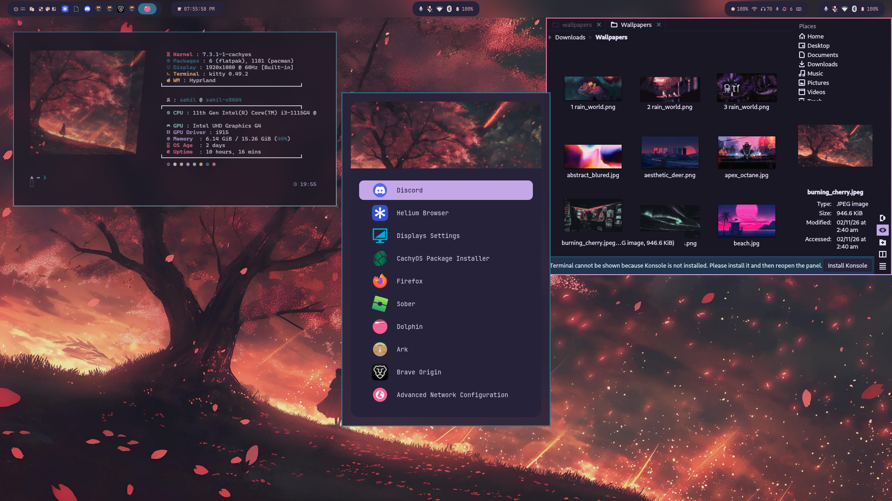

# My HyDE Dotfiles

**My CachyOS + Hyprland desktop, ready to install.**
HyDE on a bare CachyOS install (no desktop environment), in the Catppuccin Mocha theme.



## What you get

- **Theme.** Catppuccin Mocha, built into HyDE. Dark with soft pastel accents, and colors that follow the wallpaper through Wallbash.
- **Bar.** Waybar across the top.
- **Launcher.** A Rofi app grid with icons and a banner image.
- **Terminal.** Kitty with a fastfetch card showing system info.
- **Files.** Dolphin, themed to match through Kvantum and qt6ct.

## What's in here

| Path | What it is |
|---|---|
| `home/` | A mirror of `$HOME`. Everything in it lands at the same path on your machine. |
| `paths.txt` | The list of files and folders that are tracked. Edit it to add or drop things. |
| `collect.sh` | Copies your live config into `home/` so you can commit it. |
| `install.sh` | Puts `home/` onto a machine that already has HyDE. Backs up first. |

## Install

You need CachyOS with HyDE already installed and working.

```
git clone https://github.com/UntitledBro1/hyde-dotfiles
cd hyde-dotfiles
bash install.sh
```

The script lists what it will change and asks once. Everything it replaces is copied to `~/.config/hyde-dotfiles-backup/<time>/` first. It skips `monitors.conf` and `nvidia.conf` because those belong to the machine; add `--with-machine` if you want them too.

Other flags: `--dry-run` shows the plan and changes nothing, `--yes` skips the prompt.

Then run `hyde-shell reload && hyprctl reload`, or log out and back in.

### Installing with an AI agent

Paste this repo's link into your coding agent and ask it to install the dots. For the agent:

1. Confirm HyDE is installed: `command -v hyde-shell` should succeed. Stop if it doesn't.
2. Clone and run the installer without the prompt:
   ```
   git clone https://github.com/UntitledBro1/hyde-dotfiles ~/hyde-dotfiles
   bash ~/hyde-dotfiles/install.sh --yes
   ```
3. Tell the user where the backup folder is (the installer prints it).

Don't copy files into `~/.config` by hand or edit `monitors.conf`. The installer backs up everything it replaces; hand edits skip that.

## Theme and wallpaper

Select **Catppuccin Mocha** in HyDE's theme picker (`Super + Shift + T`). It ships with HyDE, so there is nothing to import.

Use any wallpaper you like and Wallbash will recolor the desktop to match.

## Make it yours

- **Hyprland settings and keybindings:** `~/.config/hypr/hyprland.lua`
- **HyDE options:** `~/.config/hyde/config.toml`
- **Bar:** `~/.config/waybar/`

## Keeping it up to date

After you change your setup, snapshot it and push:

```
bash collect.sh
git add -A && git commit -m "update" && git push
```

`collect.sh` also scans for lines that look like API keys or passwords. The two "Password:" hits in the hyprlock files are just label text.

## Undo

Backups mirror your home folder, so restoring is one command:

```
cp -a ~/.config/hyde-dotfiles-backup/<time>/. ~/
hyde-shell reload && hyprctl reload
```

## Notes

- Built and used on CachyOS. Other setups are untested.
- HyDE is moving from `.conf` files to a Lua-based Hyprland config. `paths.txt` lists both layouts and skips whichever you don't have.
- Updating HyDE can overwrite some files it manages. Re-run `bash install.sh` afterwards if something reverts.

## Credits

- [HyDE](https://github.com/HyDE-Project/HyDE) by the HyDE Project, MIT licensed.
- Install flow modelled on [denonmaryland/omarchy-dotfiles](https://github.com/denonmaryland/omarchy-dotfiles).
- Catppuccin palette and wallpapers belong to their creators.

## License

MIT. See `LICENSE`.
